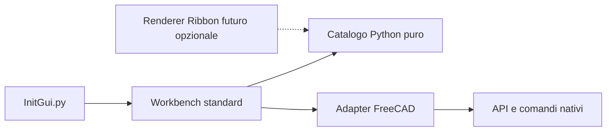

# Architettura iniziale

## Problema e modello di interazione

Una ribbon da sola non rende il workflow equivalente a SolidWorks. La prima priorità è accompagnare il percorso **documento → Body → sketch → vincoli → feature → modifica** con meno cambi manuali di workbench e messaggi comprensibili. ET UX aggiunge una presentazione sopra FreeCAD: salvataggio FCStd, albero parametrico, geometria, selezione e solver restano nativi.

| Concetto familiare | Fondamento FreeCAD | Ruolo previsto per ET UX |
| --- | --- | --- |
| CommandManager / schede contestuali | menu, toolbar, registro comandi | gruppi per attività, poi eventuale renderer Ribbon |
| schizzo e feature del pezzo | Sketcher, PartDesign, Body attivo | suggerire prerequisiti e instradare comandi nativi |
| PropertyManager | task panel nativi | indicazioni contestuali, evitando di sostituire un task già in modifica |
| FeatureManager | albero del documento | navigazione complementare; nessun albero parallelo iniziale |
| assieme | Assembly e addon diversi | milestone separata, con adattatori per capacità effettivamente presenti |

Questa mappatura non promette equivalenza tra i modelli dati: Body, Part e documento FreeCAD hanno semantiche proprie. Non imporre un Body al documento senza azione esplicita.

## Confini dei moduli

**Implementato:** catalogo immutabile di un gruppo e un comando, adapter con registrazione idempotente, factory della workbench che riceve la classe base fornita dal loader, icona e ingressi minimali. `Initialize` costruisce menu/toolbar una sola volta per istanza. `Activated` e `Deactivated` sono intenzionalmente vuoti: nessun observer o stato persistente da gestire. La classe registrata si chiama `ETUXWorkbench`.

**Proposto, non implementato:** snapshot immutabile del contesto (documento, Body attivo, selezione, modalità modifica), regole pure che producono capacità/azioni disponibili e adapter che verifica il contesto immediatamente prima di invocare un comando. La UI visualizza le ragioni per cui un'azione è indisponibile. Lo stato viene riletto all'attivazione; non si salva il documento nel modello puro.

Quando si introdurranno comandi Sketcher/PartDesign, caricare i moduli GUI necessari in modo esplicito e verificare gli ID con `Gui.listCommands()`. La disponibilità di un ID non dimostra che il comando sia eseguibile nel contesto attuale: rispettare l'attivazione nativa e il task in corso. Non cambiare workbench mentre una feature è in modifica senza una strategia documentata. Non caricare tutte le workbench all'avvio per raccogliere azioni.

## Estensione e reversibilità

Il primo renderer usa `appendMenu` e `appendToolbar`; non accede a widget interni della finestra. In seguito un piccolo contratto di presentazione potrà ricevere gruppi e azioni già risolte. Il renderer non prende decisioni sul workflow. Non si crea ora una gerarchia di backend senza un secondo backend funzionante.

Preferenze future: namespace `User parameter:BaseApp/Preferences/Mod/ETFreeCADUX`, defaults conservativi, schema/versione espliciti e nessuna scrittura all'import. Non modificare preferenze Ribbon. Un componente attivato deve rilasciare observer, timer e connessioni in disattivazione; salvare e ripristinare solo stato che possiede. Errori di un'estensione opzionale devono lasciare disponibile il renderer standard e produrre una diagnosi nel Report.

## Compatibilità e test

Riferimento principale FreeCAD 1.1.3, con 1.0 come compatibilità secondaria; libreria Python pura compatibile con Python 3.8+. Qt non è importato dal prodotto iniziale. Per widget futuri usare il facade PySide fornito da FreeCAD e isolare differenze Qt5/Qt6 negli adapter, con prove su build reali. Non dedurre il binding solo dalla versione di FreeCAD.

Tre livelli di verifica:

1. Test senza host: import pulito, catalogo, registrazione ripetuta, lifecycle e comando senza documento.
2. Smoke con API reali: registrazione tramite `InitGui.py`, menu/toolbar, esecuzione e tre cambi di workbench senza duplicazione. Il test cloud usa una GUI offscreen minimale e non il loader completo degli addon.
3. Accettazione desktop futura: scoperta automatica da `Mod`, riavvio, navigazione da tastiera, scala DPI, temi, cambio documento, chiusura/riapertura, Undo/Redo per le azioni di modellazione e coesistenza con addon.

I primi due livelli sono verificati su 1.1.3/Qt6 e 1.0/Qt5. Il runner aggiunge quattro prove geometriche native (solido, booleano, Undo/Redo e FCStd) in documenti temporanei; non sono funzioni di modellazione ET UX. Il comando iniziale resta informativo. Il livello desktop rimane da eseguire. Vedi [requisiti](REQUIREMENTS.md) e [runtime](FREECAD_113_CLOUD.md).

## Decisioni rinviate

Licenza e metadati di distribuzione, release oltre quelle verificate, integrazione opzionale Nxt e rendering Ribbon, schema dei profili, traduzioni Qt, scorciatoie e navigazione SolidWorks-like. Stabilire queste scelte con piccoli prototipi e criteri della roadmap, evitando dipendenze non necessarie.

## Strategia di riuso pre-V0.2

Nxt è un addon trasversale alle workbench con model panel, inspector, menu TOML e servizi di sessione; non è un renderer Ribbon intercambiabile. ET UX mantiene il proprio core Python puro e si concentra sul percorso guidato e sui prerequisiti dei comandi nativi. Prima di introdurre uno strumento avanzato, verificare se un comando Nxt o nativo già copre il bisogno. La scelta e i confini sono descritti nel [confronto](EXTENSIONS_COMPARISON.md). Non importare servizi Nxt o FCBinding per riutilizzarli direttamente.
