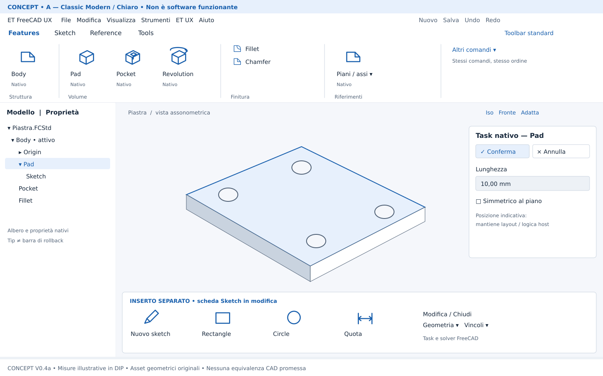
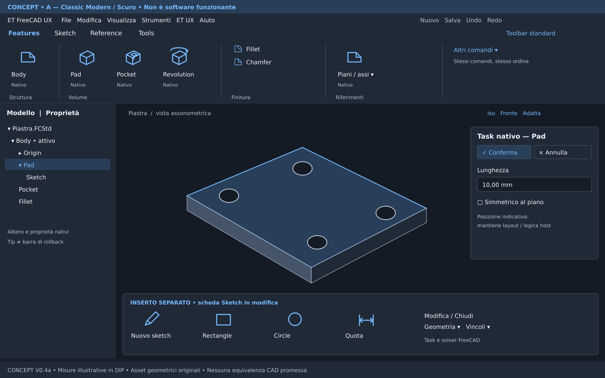
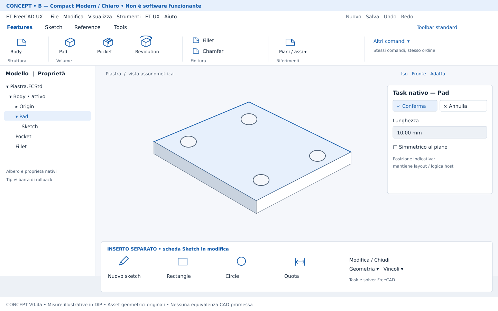
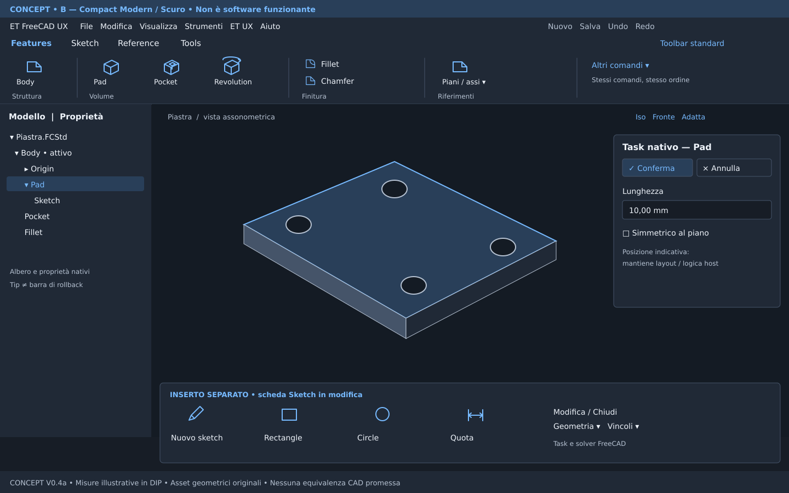

# ET-FreeCAD-UX — V0.4a: Familiar Workflow, Modern Interface

**Studio UX e concept, non implementazione.** 14 ottobre 2026, Europe/Rome.
Base: ultimo `main` controllato via API GitHub e checkout esistente,
[`f8e6df995037315a355053db43c3dff7915c74f3`](https://github.com/Tury991/ET-FreeCAD-UX/commit/f8e6df995037315a355053db43c3dff7915c74f3).
V0.3b resta la versione funzionante; V0.4a identifica questa proposta di design.

## Direzione e raccomandazione

Per chi usa SolidWorks professionalmente, la familiarità nasce soprattutto da
posizioni stabili, gerarchia dei comandi e continuità tra selezione, sketch,
feature e modifica. Una Ribbon esteticamente simile da sola non preserva la
memoria muscolare. Proponiamo **Classic Modern come riferimento iniziale** e
**Compact Modern come modalità di densità alternativa**, con identico ordine,
nomi e gruppi. La scelta definitiva richiede una prova comparativa con l'utente.

L'organizzazione prende spunto dal workflow documentato di SolidWorks, senza
riprodurne codice, icone, marchi, screenshot o asset. I nomi SolidWorks,
CommandManager, FeatureManager e PropertyManager sono riferimenti descrittivi,
non nomi da applicare ai componenti ET UX. Non c'è affiliazione.

Questa PR aggiunge solo il presente documento e asset di progettazione. Non
cambia codice, catalogo, toolbar, Ribbon, preferenze, manifest, dipendenze o
versione. Tutti gli interventi descritti di seguito sono **futuri**.

## Metodo, evidenze e limiti della ricerca

- Lettura di README, AGENTS e documentazione `docs/`, catalogo, adapter,
  workbench e renderer V0.3b alla base fissata. I riferimenti ai file locali
  descrivono quella revisione, non un comportamento inventato dai mockup.
- Ispezione dei [tre screenshot FreeCAD esistenti](screenshots/): Features,
  Sketch e toolbar standard. Sono evidenze visive della base, distinte dai
  concept qui creati. La documentazione storica contiene ancora frasi «nessuno
  screenshot incluso»: il merge successivo ha aggiunto i PNG, non una nuova
  certificazione desktop.
- Ricerca nella documentazione ufficiale SolidWorks per disposizione, pannelli,
  scorciatoie e mouse; fonti in fondo. Alcune pagine restituiscono al browser
  solo il contenitore Web Help: in quei casi sono stati usati gli estratti
  indicizzati, senza pretendere una lettura integrale o un audit pixel per pixel.
- Nessuna sessione interattiva SolidWorks o FreeCAD eseguita per questo studio;
  nessun addon terzo installato/eseguito. Le conclusioni ergonomiche sono
  ipotesi progettuali, da verificare, non risultati di usabilità.
- Riferimento tecnico FreeCAD 1.1.3; 1.0 secondario. Le evidenze preesistenti
  in [VALIDATION_V03B](VALIDATION_V03B.md) separano host/offscreen da desktop,
  DPI, temi e coesistenza addon. Qui non si amplia quella matrice.

## Differenze che incidono sul passaggio quotidiano

| Area | Workflow SolidWorks di riferimento | ET UX V0.3b osservata | Attrito / proposta |
| --- | --- | --- | --- |
| CommandManager | Schede per attività; Features e Sketch costituiscono due punti di accesso principali; configurabili [S1, S2] | Ordine `Sketch, Features, Reference, Tools`; sette azioni Sketch e sei Features; schede statiche | Proporre `Features, Sketch, Reference, Tools`, stabile in A/B; ordine da validare sul profilo professionale dell'utente |
| Gerarchia | Operazioni di volume, finitura e strumenti sketch riconoscibili per attività [S2, S8] | Tutte le azioni equivalenti: icone 20 px, testo a fianco, due righe; griglia riempita per colonne | Rendere Pad/Pocket/Revolution e geometrie principali prominenti; secondari in gruppi con etichette; evitare riordini dinamici |
| Sketch → feature | È possibile iniziare dalla feature e avviare lo sketch necessario, oppure creare prima lo sketch [S8] | Percorso esplicito documento → Body → sketch → chiusura → selezione → Pad/Pocket; Sketcher può cambiare workbench | Rendere i passaggi visibili; non promettere feature-first automatico né ritorno automatico ET UX con sola estetica |
| FeatureManager | Albero a sinistra, storia e accesso alla modifica; funzioni di filtro e rollback [S3] | Albero/proprietà nativi; documento, Body, Origin, feature e sketch; attivazione Body esplicita | Mantenere posizione sinistra e gerarchia reale; spiegare Body attivo e Tip. Tip non equivale alla barra di rollback SolidWorks |
| PropertyManager | Molti comandi aprono proprietà nel manager laterale; conferma/annullamento con significato preciso [S4] | Task panel nativo; parametri, validazione, preview e Undo nativi; disposizione dipende dall'host | Una sola autorità di conferma: task nativo. Nessuna seconda spunta nel viewport che bypassi validazione |
| Selezione | Preselezione/selezione nel viewport e albero, strumenti contestuali per l'entità [S5] | QAction native e selezione FreeCAD; nessuna logica ET UX aggiuntiva | Preservare selezione e modificatori; suggerire prerequisiti senza ridurre abilitazione a regole approssimative |
| Menu contestuali | Menu e toolbar contestuale; accesso anche da tastiera [S5] | Menu contestuali host; workbench ET UX non definisce un `ContextMenu` proprio | Eventuale piccolo gruppo ET UX tramite hook pubblico, senza rimpiazzare voci native; niente DSL generico |
| Shortcut | `S` apre shortcut bar, spazio orientamento, Shift+F10 menu contestuale [S5] | Nessun preset ET UX; shortcut host e utente restano attive | Prima inventario conflitti; eventuale preset opt-in per azioni native. Spazio in FreeCAD ha già un uso di visibilità: non sostituirlo automaticamente |
| Mouse 3D | MMB trascinato ruota; Ctrl+MMB esegue pan [S6] | Stile di navigazione host; screenshot base mostra CAD; ET UX non lo cambia | Provare per primo lo stile nativo SolidWorks già incluso [F2]; guidare la scelta esplicita, nessuna rimappatura globale degli eventi |
| Orientamento | Orientamento/selector, viste standard e adatta; spazio è un accesso familiare [S5] | Navicube, viste e comandi host; non catalogati nella Ribbon ET UX | Accesso discreto a Iso/Fronte/Adatta tramite comandi disponibili; preservare Navicube e indicatori assi |
| Accesso completo | Personalizzazione e superfici multiple [S1] | Catalogo ridotto: 24 azioni native + due informative; Tools e menu restano disponibili | Distinguere scorciatoie della Ribbon da disponibilità nativa; non presentare una Ribbon parziale come copertura di tutto FreeCAD |

Il sorgente ufficiale 1.1.3 include già `SolidWorksNavigationStyle`: è il primo candidato per la memoria muscolare del mouse, senza nuovo codice. Implementa MMB per rotazione, Ctrl+MMB per pan e rotella per zoom; contiene anche logica specifica per selezione in modifica Sketcher. Questo è un riscontro statico, non una prova del comportamento sul desktop o di ogni dispositivo. Nessuno stile o preferenza è stato cambiato.

La priorità è **gerarchia → continuità → accessi rapidi**, poi rifinitura cromatica.
La differenza Body/feature e i task nativi devono rimanere comprensibili: chiamare
Pad «Estrusione» senza spiegare il modello FreeCAD può creare aspettative errate.

## Architettura delle informazioni comune ad A e B

Le schede restano visibili e nella stessa posizione. Nel concept Features è
prima perché è il riferimento di modellazione del pezzo; Sketch segue. Un
cambio di contesto futuro può evidenziare la scheda utile senza spostare i
pulsanti, forzare una workbench o terminare il task corrente.

| Scheda / gruppo | Primo piano | Secondari / accesso completo |
| --- | --- | --- |
| Features / Struttura | Body, accesso di avvio distinguibile | Spiegazione Body attivo; nessuna auto-creazione |
| Features / Volume | Pad, Pocket, Revolution | Non aggiungere ora Loft, Sweep, Hole o Pattern; ampliamento catalogo separato con verifica ID |
| Features / Finitura | Fillet | Chamfer accanto nello stesso gruppo, più compatto |
| Features / Riferimenti | Collegamento al gruppo Reference | Piani/assi tramite menu esplicito; azioni complete nella scheda Reference |
| Sketch / Sessione | Nuovo sketch | Modifica e Chiudi con stato nativo, senza fingere che tutti siano attivi |
| Sketch / Geometria | Rectangle, Circle | Futuri Line/Arc ecc. solo dopo capability check, fuori da questa PR |
| Sketch / Quote e vincoli | Accesso Quota | Menu esplicito Distanza e Raggio, usando le due azioni native; non promette Smart Dimension equivalente |
| Reference | Piano e riferimenti frequenti | Linea, Punto, CoordinateSystem, SubShapeBinder, tutti conservati |
| Tools | Nuovo, Salva, Undo/Redo | Ricalcolo, Preferenze native, Guida, Informazioni; nessuna voce rimossa |

«Altri comandi» nei concept è una proposta di accesso al menu ET UX completo,
non un motore di ricerca nuovo. I menu a freccia devono aprire un elenco reale,
non un comando ambiguo con un comportamento deciso dalla selezione. I nomi
visibili finali e le traduzioni restano quelli delle QAction; il documento può
affiancare la terminologia italiana, senza alterare ID o semantica.

## A — Classic Modern

Organizzazione molto vicina alla logica di un CommandManager per attività:
barra superiore, schede esplicite, grandi comandi di volume, gruppi separati,
albero a sinistra e parametri nel task host. Superfici piatte, spaziatura regolare,
bordi sottili, angoli 4–6 DIP e accento blu originale.

- Icone principali target **40 DIP**, testo sotto; hit target almeno 44×44 DIP.
- Secondari **20–24 DIP**, testo affiancato su due righe dentro il gruppo;
  etichetta del gruppo sempre leggibile. Finitura e riferimenti non devono
  competere visivamente con i tre comandi di volume.
- Area comandi indicativa **152 DIP**, oltre a schede e menu; altezza reale
  calcolata da font e metriche. Più facile riconoscere le attività a colpo d'occhio.
- Albero sinistro circa 260–300 DIP, ridimensionabile; task nella posizione
  scelta dall'host/utente. La familiarità deriva dalla sequenza e dai riferimenti
  visivi, senza richiedere un PropertyManager sostitutivo.

**Chiaro — concept:**

**Scuro — concept:**

## B — Compact Modern

Identica organizzazione e identici nomi. Riduce il padding e la fascia verticale,
con icone principali ancora grandi rispetto ai secondari. Nessun comando
primario scompare per ottenere spazio e nessuna scheda viene riordinata.

- Icone principali **32 DIP**, testo sotto; secondarie **20 DIP** con etichetta.
- Area comandi indicativa **96 DIP**, schede escluse. Hit target primari almeno
  44×44 DIP; secondari almeno 32 DIP in altezza, aumentabili per touch/font grandi.
- Menu di gruppo compatti e testo leggibile; no modalità solo icone obbligatoria.
- Stessi pannelli host; possibile collasso della sola Ribbon ET UX su scelta
  dell'utente, mai nascondere automaticamente i parametri durante un task.

**Chiaro — concept:**

**Scuro — concept:**

Gli inserti Sketch sono **stati separati**, non una seconda Ribbon simultanea.
La piastra e i simboli sono illustrazioni geometriche originali. Albero, task e
controlli nelle tavole sono schematici: non rappresentano widget funzionanti,
non garantiscono che l'host usi quelle etichette/posizioni e non costituiscono
una proposta di riscrittura dei pannelli. Le icone sono segnaposto originali,
non un set pronto per sostituire le icone native. File editabili e provenienza:
[asset e note](design/v0.4a/README.md).

## Confronto e decisione

| Criterio | A — Classic Modern | B — Compact Modern |
| --- | --- | --- |
| Familiarità spaziale | Maggiore separazione tra attività, più simile alla logica dei gruppi professionali | Stessa sequenza, meno separazione verticale |
| Riconoscimento comandi | Icone 40 DIP, gruppi più evidenti | 32 DIP; più richiesta di riconoscimento su schermi densi |
| Viewport | Occupa più altezza | Recupera 56 DIP rispetto ad A nel disegno |
| Schermi piccoli | Più overflow; serve collassare gruppi | Migliore uso del 1366×768, ma le etichette restano vincolanti |
| Font grandi / DPI | Più margine, comunque da adattare | Necessario aumentare altezza; 96 DIP non è un limite rigido |
| Implementazione | Variante del renderer locale, senza addon | Stesso renderer e catalogo; maggiore attenzione ai minimi |
| Rischio UX | Possibile spazio eccessivo e somiglianza solo superficiale | Possibile densità eccessiva, comandi secondari meno scopribili |

A parità di viewport largo 1163 DIP, il solo recupero verticale di B vale
**1163×56 = 65.128 DIP²** di area potenziale. È un calcolo sul concept, non una
misura dell'host né una percentuale di produttività. Rispetto ai **116 DIP**
attuali del contenitore V0.3b, A costa 36 DIP e B ne recupera 20, considerando
solo quella fascia: toolbar native e decorazioni host non entrano nel confronto.

**Decisione proposta:** prima A per validare posizioni e linguaggio; offrire B
come scelta esplicita di densità usando lo stesso schema. Non introdurre due
workbench o due cataloghi divergenti. Non cambiare automaticamente modalità
quando l'utente ridimensiona: adattare i gruppi preservando la scelta.

## Tema, stato e accessibilità

| Token illustrativo | Chiaro | Scuro |
| --- | --- | --- |
| Superficie | `#FFFFFF` | `#202936` |
| Viewport illustrativo | `#F5F7FB` | `#141B24` |
| Testo | `#17283C` | `#EEF3FA` |
| Testo secondario | `#506176` | `#B6C2D2` |
| Accento | `#175EAC` | `#77BAFF` |
| Selezione | `#E7F0FC` | `#293F59` |
| Bordo decorativo | `#C9D3DF` | `#455469` |

Sono token di progetto, non stylesheet globali. Per una futura UI leggere la
palette e il font dell'host, applicare styling solo ai widget ET UX e mantenere
fallback a palette nativa, incluso contrasto elevato. Non cambiare automaticamente
sfondo 3D, colori del modello, tree o task. Le due tavole mostrano un'ambizione
visiva complessiva, non la promessa di tematizzare l'intero host via API Python.

Obiettivi: contrasto testo normale almeno 4,5:1, simboli e focus almeno 3:1 sul
fondo adiacente. I bordi sottili delle tavole sono decorativi: in produzione il
focus richiede un contorno più forte. Selezione, errore e disabilitazione devono
avere anche testo/stato/iconografia: mai solo colore. Tooltips con nome, scopo e
prerequisiti; stato disabilitato coerente con l'azione nativa. Ordine tab per
gruppi, frecce per schede/menu, focus visibile e ritorno al pulsante invocante
quando il menu chiude. Testare accesso ai comandi senza mouse; nessuna scorciatoia
riservata all'estetica deve interferire con editor numerici o console.

## Risoluzioni, DPI e localizzazione

DIP indica coordinate logiche Qt, non pixel fisici. Non moltiplicare manualmente
per il devicePixelRatio se Qt sta già gestendo lo scaling. Icone SVG originali
per eventuali nuovi comandi ET UX; conservare risorse e traduzioni native per
azioni native. Misurare il testo con metriche font, non con larghezze fisse.

| Spazio logico disponibile alla Ribbon | Regola proposta, comune A/B |
| --- | --- |
| ≥1280 DIP | Gruppi espansi; tutti i primari con etichetta |
| 960–1279 DIP | Ridurre padding; riferimenti e secondari in menu nominati; ordine stabile |
| 720–959 DIP | Collassare prima Riferimenti, poi Finitura; mantenere Volume e Sessione sketch |
| <720 DIP | Scroll orizzontale accessibile + menu completo ET UX; nessun comando irraggiungibile |

Le soglie sono punti di partenza, non media query implementate: adattare sul
fabbisogno dei gruppi. Non troncare silenziosamente etichette e non scambiare
posizione a Pad/Pocket dopo il resize. Con font grandi aumentare la fascia;
scroll come fallback, mai taglio verticale. I menu di gruppo espongono tutti i
secondari e la navigazione tastiera; mantenere sempre `Toolbar standard` e
menu ET UX raggiungibili. La fascia Tools conserva tutte le azioni originali.

Matrice futura: 1366×768, 1920×1080 e 2560×1440 a 100/125/150/200%, font 100/125/150%,
finestra stretta, passaggio tra monitor con DPI diversi; italiano e inglese con
etichette lunghe. Una PNG ridotta da GitHub non è una prova DPI.

## Fattibilità: API pubbliche, Qt e confini invasivi

**P** = superficie pubblica FreeCAD / comandi nativi; **Q** = UI Qt locale,
senza contratto di layout globale host; **I** = richiede integrazione invasiva
oppure un nuovo componente sostanziale. La presenza di API non equivale a
comportamento già testato su tutte le build.

| Intervento futuro | Classe / superficie | Limite / decisione |
| --- | --- | --- |
| Gruppi, menu, toolbar e ordine | P: `Workbench.appendToolbar`, `appendMenu`, `Gui.listCommands`, `Gui.addCommand` | Capability check; mantenere fallback e semantica native |
| Densità A/B, dimensioni icone, menu secondari | Q: QtWidgets del binding host, QAction già risolte dall'adapter ET UX | Non è una API Ribbon ufficiale FreeCAD; riuso QAction già presente, niente copia algoritmo o renderer esterno |
| Tema della sola Ribbon ET UX | Q: palette/font/style locali | Tema globale uniforme di tree/task/viewport non garantito; vietato stylesheet della main window |
| Guide per selezione e Body attivo | P: `Gui.Selection` e observer pubblici [F1] | Observer posseduti e rimossi; suggerimenti read-only, stato nativo autorevole, più documenti/task da provare |
| Menu contestuale ET UX limitato | P: hook Workbench `ContextMenu` / `appendContextMenu` | Aggiungere un gruppo, non rimuovere voci host; controllare destinatario e selezione; valutare Nxt prima di duplicare |
| Viste standard e Adatta | P: comandi `Std_View*` disponibili oppure API pubblica `activeView()` | Verificare ID e vista 3D effettiva; niente dispatch su schede non 3D o documenti chiusi |
| Preferenza manuale dello stile mouse | P: dialogo e stili nativi documentati nel sorgente host [F2] | Stile nativo `SolidWorks` già presente: MMB ruota, Ctrl+MMB pan, rotella zoom. Prova desktop necessaria, nessuna scrittura automatica né equivalenza universale |
| Shortcut utente per comandi nativi | P: dialogo Personalizza; Q per eventuale popup ET UX futuro | Inventario conflitti prima; non intercettare tasti globalmente, non scrivere scorciatoie ora |
| Task proprio per un nuovo comando ET UX | P: `Gui.Control.showDialog/closeDialog` [F3] | Adatto ai propri task; non è un'API per ridisegnare internamente i task nativi o confermarli arbitrariamente |
| Albero left e dock resize | Layout nativo scelto dall'utente | Non promettere un posizionamento fisso universale, overlay/versioni host differenti |
| Cambio scheda in edit sketch | P/Q solo se stato esposto pubblicamente e lifecycle verificabile | Non esiste nel prodotto; evitare polling del widget privato, forzatura Sketcher/ET UX o auto-chiusura task |
| PropertyManager SolidWorks uniforme | I: sostituzione/reparenting dei widget task nativi, controllo accettazione | Escluso. Il task nativo conserva validazione, preview e transazioni; spunte duplicate non sicure |
| FeatureManager completo e barra rollback | I: nuovo albero, dipendenze, soppressione/rollback con semantica diversa | Escluso. Tip non è rollback; valutare nativo/Nxt in esperimento separato [F4] |
| Gestualità mouse identica in ogni editor | I se richiede patch ai navigation handler o filtri globali | Esclusa; preset nativo più vicino e documentazione, senza monkey patch |
| Feature-first automatico e ritorno dalla modifica | Nuova logica di workflow, non styling | Richiede stati, transazioni e failure path; rinviato a proposta separata con criteri verificabili |

Non confondere l'uso di `Gui.getMainWindow()` con un contratto pubblico sui nomi,
struttura o posizione di tutti i widget host. `findChild` su pannelli interni,
reparenting e monkey patch non sono una scorciatoia accettabile per la familiarità.
La fattibilità visuale completa è limitata soprattutto dai task e dal tree nativi.

## Nessuna perdita di funzionalità native

Per una futura implementazione: tutte le 24 azioni native e le due informative
restano raggiungibili nel menu/toolbar standard; il toggle Ribbon resta accessibile.
Le azioni secondarie compattate restano nominabili e navigabili. I comandi non
inclusi nel catalogo restano accessibili dalle proprie workbench/menu host:
non si promette di inserirli tutti in ET UX. Nessuna toolbar di altre workbench
viene nascosta; niente sostituzione dei menu globali o cancellazione di shortcut.

Conservare stessa QAction, abilitazione, traduzione, selezione, dialoghi,
transazioni Undo/Redo, errori geometrici e salvataggio FCStd. In caso di comando
assente: omissione dichiarata e guida, senza alias inventati. In caso di errore
renderer: ripristino standard. Cleanup su disattivazione, cambio documento e
chiusura, anche annullata; snapshot delle sole superfici ET UX. Il precedente
problema di `hide()`/visibilità persistita è un vincolo reale, documentato in
[RIBBON_V03A](RIBBON_V03A.md); non reintrodurlo per motivi estetici.

## Priorità proposte e criteri di uscita

| Priorità | Lavoro futuro | Criterio verificabile |
| --- | --- | --- |
| P0 | Validare con l'utente mappa Features/Sketch e differenze Body/task; scegliere densità | Completare percorso pezzo e modifica senza cercare i comandi in schede sbagliate; registrare errori e preferenza |
| P1 | Gerarchia/gruppi locali A/B sul catalogo invariato, riuso QAction e fallback | 24+2 azioni raggiungibili, nessuna duplicazione; stessa abilitazione; menu tastiera; 5 toggle e cambi workbench; nessuna toolbar esterna alterata |
| P1 | Font, DPI, temi e overflow | Matrice sopra senza testo tagliato o comandi persi; contrasto e focus controllati; no preferenze modificate dopo restart |
| P2 | Guida contestuale e accesso viste native | Ridurre esitazioni su Body/Sketch/Pad e orientamento; più Body/documenti; nessun observer residuo |
| P2 | Preset shortcut opzionale; guida allo stile mouse nativo SolidWorks | Conflitti esplicitati, opt-in/reversibilità, focus editor rispettato; nessuna rimappatura silenziosa |
| P3 | Continuità sketch/feature o ampliamento catalogo, solo con studio dedicato | Riduzione misurata dei passaggi; Undo/Redo e annullamento affidabili; capability e lifecycle testati |
| Escluso | Tree/PropertyManager nuovi, patch host, editor Ribbon completo, dipendenze Nxt/Ribbon | Eventuale ricerca separata; non prerequisiti V0.4a |

Le priorità non cambiano la roadmap di versioni già validate. Prima di una
implementazione leggere [EXTENSIONS_COMPARISON](EXTENSIONS_COMPARISON.md): Nxt
copre già tree, inspector, isolate, gizmo e menu; Ribbon un renderer/editor più
ampio. Non installarli come dipendenze di questa proposta, non copiarne asset
né dichiarare compatibilità non provata.

## Protocollo di confronto desktop futuro

Eseguire V0.3b, A e B nello stesso profilo di prova e con gli stessi comandi;
alternare l'ordine A/B per contenere l'effetto apprendimento. L'utente lavora
prima senza suggerimenti, poi commenta i punti di attrito. Con un solo utente
il risultato è una decisione personale, non evidenza statistica generalizzabile.

1. Documento, Body, sketch XY, cerchio R5, Pad 10; ritorno sketch R7 e ricalcolo.
2. Sketch su faccia, Pocket; selezione spigoli, Fillet/Chamfer; selezione errata,
   annullamento del task e ripresa senza feature parziali.
3. Modifica da albero e proprietà, Undo/Redo, salva/riapri; due Body e due
   documenti con cambio workbench durante e dopo un task.
4. Orienta Fronte/Iso, adatta, ruota/pan/zoom; trova gli accessi familiari senza
   perdita del Navicube; menu contestuale viewport e albero, solo tastiera.
5. Ripeti con finestra stretta, DPI/temi, disattivazione e riavvio; controlla
   stato, selezione, toolbar, menu e preferenze originali.

Registrare tempo per attività, cambi workbench, clic/ricerche non riusciti,
errori di selezione/conferma e valutazione della leggibilità. Gate: nessuna
regressione funzionale; scelta A/B motivata da osservazioni, non solo da gusto.
Screenshot concept, SVG e unit test non provano questi risultati.

## Fonti

Fonti consultate il 14 ottobre 2026. Parafrasi e sintesi, nessun asset riprodotto.
I layout SolidWorks sono personalizzabili: non si pretende un ordine universale
per tutte le versioni o per il profilo aziendale dell'utente.

- **S1:** [CommandManager](https://help.solidworks.com/2026/english/SolidWorks/sldworks/c_commandmanager.htm) e [Access to Tools](https://help.solidworks.com/2019/english/SolidWorks/acadhelp/c_Access_to_Tools.htm): schede, accessi e personalizzazione.
- **S2:** [Screen Layout](https://help.solidworks.com/2022/english/SolidWorks/acadhelp/c_Screen_Layout.htm): Features e Sketch nell'organizzazione del pezzo.
- **S3:** [FeatureManager Design Tree](https://help.solidworks.com/2025/english/SolidWorks/sldworks/c_featuremanager_design_tree.htm) e [FeatureManager Options](https://help.solidworks.com/2025/english/SolidWorks/sldworks/HIDD_OPTIONS_FEATURE_MANAGER_swoptions.htm): albero sinistro e filtro; [navigazione e rollback](https://help.solidworks.com/2025/english/SolidWorks/sldworks/r_featuremanager_design_tree_arrow_navigation.htm?format=P&value=).
- **S4:** [PropertyManager Overview](https://help.solidworks.com/2022/english/solidworks/sldworks/r_pm_overview.htm) e [Manager Pane](https://help.solidworks.com/2026/english/SolidWorks/sldworks/c_management_panel.htm): parametri e gestione comando nel pannello.
- **S5:** [Selected Keyboard Shortcuts](https://help.solidworks.com/2026/english/SolidWorks/sldworks/c_time_saving_keyboard_shortcuts.htm) e [personalizzazione delle shortcut](https://blogs.solidworks.com/products/solidworks/useful-keyboard-shortcuts-workflow-customizations-solidworks/): accessi contestuali, orientamento e shortcut bar.
- **S6:** [Middle Mouse Button Functions](https://help.solidworks.com/2024/english/SolidWorks/sldworks/r_Middle_Mouse_Button.htm?id=5.1.18): rotazione e pan in Design, non Visualize/Composer.
- **S8:** [Sketching the Base](https://help.solidworks.com/2027/english/swtutorialonline/t_tut_lesson1_sketchingbase.htm): esempio ufficiale di feature-first e sketch-first; pagina 2027 indicizzata, usata per il principio del workflow, non per certificare la versione professionale dell'utente.
- **F1:** [SelectionObserverPython](https://freecad.github.io/SourceDoc/df/d42/classGui_1_1SelectionObserverPython.html): osservazione pubblica selezione; documentazione generata non sostituisce verifica runtime 1.1.3.
- **F2:** [FreeCADGuiInit.py 1.1.3](https://github.com/FreeCAD/FreeCAD/blob/1.1.3/src/Gui/FreeCADGuiInit.py): hook Workbench e menu; [CommandView.cpp 1.1.3](https://github.com/FreeCAD/FreeCAD/blob/1.1.3/src/Gui/CommandView.cpp): spazio associato a `Std_ToggleVisibility`; [SolidWorksNavigationStyle.cpp 1.1.3](https://github.com/FreeCAD/FreeCAD/blob/1.1.3/src/Gui/Navigation/SolidWorksNavigationStyle.cpp): stile nativo e combinazioni mouse. Hook, Control e conflitto spazio verificati anche sul sorgente ufficiale via connettore; non eseguiti come nuove funzioni.
- **F3:** [Control.cpp 1.1.3](https://github.com/FreeCAD/FreeCAD/blob/1.1.3/src/Gui/Control.cpp): gestione task; [uso Python ufficiale in Draft 1.1.3](https://github.com/FreeCAD/FreeCAD/blob/1.1.3/src/Mod/Draft/draftguitools/gui_shapestrings.py) di `showDialog/closeDialog`, verificato via connettore. Non è un contratto per manipolare widget privati.
- **F4:** [Confronto estensioni](EXTENSIONS_COMPARISON.md), [studio Nxt](FREECAD_NXT.md), [studio Ribbon](FREECAD_RIBBON.md): analisi pregresse, non addon eseguiti in questa ricerca.
- **Base ET UX:** [catalogo](../et_freecad_ux/core/catalog.py), [renderer](../et_freecad_ux/ui/ribbon.py), [workbench](../et_freecad_ux/ui/workbench.py), [adapter host](../et_freecad_ux/adapters/freecad.py), [architettura](ARCHITECTURE.md), [validazione V0.3b](VALIDATION_V03B.md).

## Verifica della consegna documentale

Quattro SVG validi XML, senza script o risorse esterne; quattro PNG 1440×900
controllati visivamente; collegamenti locali risolti. Contrasto dei token testo,
testo secondario, accento su superficie e testo selezionato: minimo **5,26:1**
tra le coppie controllate, superiore al target 4,5:1. Questo dato riguarda i
token delle tavole, non tutti gli stati futuri o la palette host.

Regressione repository: `python3 -m unittest discover -s tests -v`, 19 casi,
18 passati e uno skip del bridge PowerShell assente nel Linux disponibile.
Nessuna nuova logica da testare; smoke CAD/geometria non rieseguiti per la sola
documentazione. La consegna non certifica GUI interattiva, DPI o compatibilità
addon. Il diff ammesso contiene esclusivamente due Markdown e otto asset
SVG/PNG sotto `docs/`.
